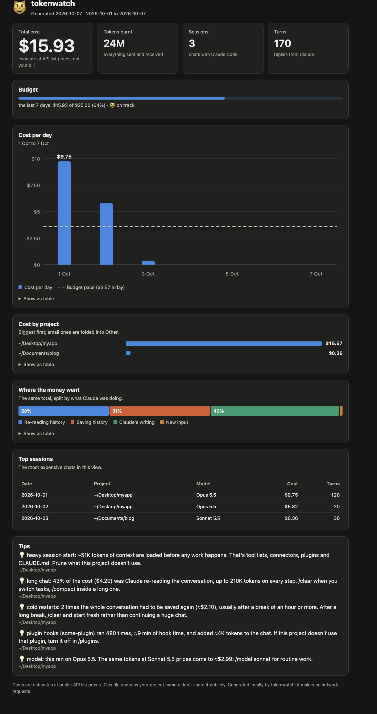

# tokenwatch

```
    /\_/\
   ( o.o )   purr-fect token watch
    > ^ <

   ┌─────────┐
   │ ◉     ◉ │   tick tock, token watch
   │   ───   │
   └──┬───┬──┘
  ╭───┴───┴───╮
  │  🪙 $$$   │
  ╰───────────╯
```

See where your Claude Code tokens actually go — and get told what to fix.

tokenwatch reads the transcripts Claude Code already keeps on your machine
(`~/.claude/projects/`) and turns them into a cost, a token count and plain advice.

## Example

A sample session, as the report shows it (generated from made-up demo data, see `examples/demo.py`; nothing here is from a real machine):

<!-- demo:session -->
```
▸ 1 Oct 10:03 · 🪙 ≈$9.75 · 🔥 22M tokens · 120 turns · Opus 5.5
  where it went: re-reading history $4.20 · saving history $4.69 · Claude's writing $0.85 · new input $0.00
  💡 long chat: 43% of the cost ($4.20) was Claude re-reading the conversation, up to 210K tokens on every step. /clear when you switch tasks, /compact inside a long one.
  💡 cold restarts: 2 times the whole conversation had to be saved again (≈$2.10), usually after a break of an hour or more. After a long break, /clear and start fresh rather than continuing a huge chat.
  💡 plugin hooks (some-plugin) ran 480 times, ≈9 min of hook time, and added ≈4K tokens to the chat. If this project doesn't use that plugin, turn it off in /plugins.
```
<!-- /demo:session -->

What it is telling you:

- **Line 1** — when the session started, what it cost, how many tokens it used, how
  many steps Claude took, and which model did the work.
- **Where it went** — the cost split four ways. *Re-reading history* is Claude reading
  the whole conversation again on every step. *Saving history* is storing new
  material (your messages, files Claude opened, its own replies) so later steps can
  re-read it cheaply. *Claude's writing* is the replies and code. *New input* is the
  small remainder that is read once without being saved.
- **💡 lines** — every suggestion that applies, biggest saving first, each with the
  number behind it. Here: the chat was too long, it was resumed after long breaks twice
  (the whole conversation had to be saved again), and a plugin's hooks ran hundreds of times.
  (The CLI report below also shows the "cheaper model" tip, on a short Opus session.)

## How to read it (no dev knowledge needed)

Everything tokenwatch prints is built from the same three parts:

- 🪙 **cost** — what the session would cost at public API prices. On a Pro/Max
  subscription you aren't billed this; read it as how fast you're using up your limit.
- 🔥 **tokens burnt** — how much text Claude read and wrote. Most of it is Claude
  re-reading the conversation so far on every step, which is why long chats get expensive.
- 💡 **suggestions** — what is most worth doing. The status line shows the top one
  (or a happy 😺 `running lean` (a worried 🙀 comes with the tip)); the report lists every one that applies.

The data is the transcripts Claude Code already saves at
`~/.claude/projects/<project>/<session>.jsonl`. tokenwatch only reads them.

**Everything is local.** No network calls, no telemetry, nothing leaves your
machine. It's a few hundred lines of dependency-free Python you can read in
one sitting.

## Install as a plugin

```
/plugin marketplace add logrelu/tokenwatch
/plugin install tokenwatch@tokenwatch
/tokenwatch:setup      # turns on the live statusline
```

This gives you the session greeting automatically, `/tokenwatch:report [--project NAME]`
for the full report, and `/tokenwatch:setup` for the statusline (plugins can't enable
a statusline on their own, so setup writes it to `~/.claude/settings.json`; re-run it
after a plugin update). The manual setup below still works if you'd rather not use the plugin.

### Updating

Plugin install:

```
/plugin marketplace update tokenwatch
/plugin update tokenwatch@tokenwatch
/tokenwatch:setup      # re-run: the statusline path points into the plugin's versioned folder
```

Cloned manually: `git pull` in your checkout; nothing else changes.

## The three surfaces

### 1. CLI report

```
python3 tokenwatch.py              # all projects, most expensive first
python3 tokenwatch.py --project myapp
```

<!-- demo:report -->
```
🤖 ━━ ~/Desktop/myapp
   🪙 ≈$15.57 · 🔥 23M tokens burnt · 2 session(s) · 140 turns
   out 312K · in 820 · cache w 989K / r 22M
   ⚠ heavy session start: ~51K tokens of context are loaded before any work happens. That's tool lists, connectors, plugins and CLAUDE.md. Prune what this project doesn't use.
   ◦ MCP actually used here: some-server (10x). Any other connected server is pure context overhead for this project.

   ▸ 2 Oct 09:34 · 🪙 ≈$5.82 · 🔥 1M tokens · 20 turns · Opus 5.5
     where it went: re-reading history $0.17 · saving history $0.25 · Claude's writing $5.40 · new input $0.00
     💡 model: this ran on Opus 5.5. The same tokens at Sonnet 5.5 prices come to ≈$2.99: /model sonnet for routine work.

   ▸ 1 Oct 10:03 · 🪙 ≈$9.75 · 🔥 22M tokens · 120 turns · Opus 5.5
     where it went: re-reading history $4.20 · saving history $4.69 · Claude's writing $0.85 · new input $0.00
     💡 long chat: 43% of the cost ($4.20) was Claude re-reading the conversation, up to 210K tokens on every step. /clear when you switch tasks, /compact inside a long one.
     💡 cold restarts: 2 times the whole conversation had to be saved again (≈$2.10), usually after a break of an hour or more. After a long break, /clear and start fresh rather than continuing a huge chat.
     💡 plugin hooks (some-plugin) ran 480 times, ≈9 min of hook time, and added ≈4K tokens to the chat. If this project doesn't use that plugin, turn it off in /plugins.

🤖 ═══ all projects: 🪙 ≈$15.57 at API list prices · 🔥 23M tokens burnt
```
<!-- /demo:report -->

Add `--json` for machine-readable output (totals, per-project and per-session numbers, tips),
for spreadsheets, dashboards or scripts:

```
python3 tokenwatch.py --json --sessions 3 | jq '.projects[].cost'
```

Limit the report to a time window (by the day each session started):

```
python3 tokenwatch.py --today
python3 tokenwatch.py --week                      # the last 7 days
python3 tokenwatch.py --since 2026-10-01 --until 2026-10-31
```

Works together with `--project` and `--json`.

### Daily trend

```
python3 tokenwatch.py --daily                    # last 14 days
python3 tokenwatch.py --daily --week --project myapp
python3 tokenwatch.py --daily --since 2026-10-01 --json
```

<!-- demo:daily -->
```
📈 █▅▁▁▁▁▁  01 Oct → 07 Oct
   Thu 01 Oct     $9.75  ████████████████████  🔥 busiest
   Fri 02 Oct     $5.82  ████████████
   Sat 03 Oct     $0.36  █
   Sun 04 Oct     $0.00  
   Mon 05 Oct     $0.00  
   Tue 06 Oct     $0.00  
   Wed 07 Oct     $0.00  
```
<!-- /demo:daily -->

Cost per calendar day, zero-filled, with a sparkline on top. Each reply counts on the day it
happened, so a session that runs past midnight is split. Nothing is stored: the history is the
transcripts Claude Code already keeps.

### Budget

```
python3 tokenwatch.py --budget 25 --period week      # period: day | week | month
export TOKENWATCH_BUDGET=25/week                     # or set it once; the flag wins
```

<!-- demo:budget -->
```
💰 last 7 days: $15.93 of $25.00 budget (64%) ▓▓▓▓▓▓░░░░ 😺 on track
```
<!-- /demo:budget -->

`week` is the last 7 days, `month` is the calendar month so far. The budget counts everything you
spent, ignoring `--project` and the date filters. 😺 on track, 😿 at 80%, 🙀 over. It also appears
in `--json` as `budget`, and in the session greeting when `TOKENWATCH_BUDGET` is set. As everywhere,
the dollar figure is at API list prices: on a Pro/Max plan read it as how fast you use your limit.

### Dashboard

```
python3 tokenwatch.py --export html                  # ./tokenwatch-dashboard.html
python3 tokenwatch.py --export html ~/Desktop/tw.html --week --budget 20
```

Writes one self-contained HTML file you can double-click: total cost, tokens, sessions and turns, cost
per day (last 14 days, or your `--since`/`--until`/`--today`/`--week` range, with a budget-pace line
when a budget is set), cost by project, where the money went, the top sessions and the tips. Every chart
has a "Show as table" view. `--project` and `--budget` work as in the report. It follows your light/dark
setting and fits a phone.



*Screenshot of the sample dashboard below: made-up data, not a real machine.*

**See it without your own data:** [`examples/dashboard-sample.html`](examples/dashboard-sample.html) is the
dashboard generated from the same made-up demo data as the examples above (project `myapp`, October 2026;
nothing from a real machine). GitHub shows HTML as source, so download the file and open it in a browser.
It is rebuilt with `python3 examples/demo.py --dashboard` and kept in sync by the tests.

It is fully local: inline CSS and SVG, a tiny inline script for hover tooltips, no network, no external
fonts or scripts. The file lists your real project names, so don't share or commit it. tokenwatch
refuses to write it inside its own checkout by default.

Projects are listed most expensive first. Each starts with its totals and the
project-wide suggestions, then its 5 most recent sessions (`--sessions 20` for more)
in the format shown in the example.

Cost prices each reply by the model that wrote it and by token kind (input,
output, cache write, cache read), using the list prices in `PRICES` at the top
of `tokenwatch.py`. Update that table when prices change. It is an estimate for
spotting waste, not an invoice.

### 2. Statusline — live burn meter inside Claude Code

```
🤖 ≈$12 · 🔥 8M tokens burnt · 120 turns
        ~(=^.^=)    purring along · $0.04/min
```

Line 2 is Purr, a cat that patrols the line and reacts to how fast you are
spending. First match wins:

- `(=@_@=)$` overheated: context over 200K or a tip is showing (the tip appears on line 1 with 🙀)
- `(=-.-=)zZ` sleepy: no turns yet, or no spend for 5 minutes
- `~(=>.<=)*` on fire: burning $0.50/min or more, runs fast
- `~(=^.^;)` warming up: $0.10/min or more, or context past 100K
- `~(=^.^=)` calm: everything else

Set `"refreshInterval": 2` so the cat animates. It adapts to narrow terminals,
honours `NO_COLOR`, and `TOKENWATCH_COLOR=0` turns its colour off.

Add to `~/.claude/settings.json` (replace the path with wherever you cloned this):

```json
{
  "statusLine": {
    "type": "command",
    "command": "python3 /path/to/tokenwatch/statusline.py",
    "refreshInterval": 2
  }
}
```

It tails the transcript incrementally (state cached in `/tmp`), so a refresh
costs ~60 ms even on huge sessions.

### 3. Session greeting — one line when a session starts

```
🤖 tokenwatch: last session cost ≈$12 · 🔥 8M tokens burnt · 120 turns. 💡 long chat: 60% of the cost ($7.20) was Claude re-reading the conversation, up to 210K tokens on every step. /clear when you switch tasks, /compact inside a long one. (+3 more: python3 /path/to/tokenwatch.py)
```

```json
{
  "hooks": {
    "SessionStart": [
      { "hooks": [ { "type": "command",
          "command": "python3 /path/to/tokenwatch/sessionstart.py 2>/dev/null || true",
          "timeout": 30 } ] }
    ]
  }
}
```

One line on purpose — advice about token waste shouldn't waste tokens. It carries the
top suggestion; the full list is in the CLI report.

### Live pet (second terminal)

The statusline can only refresh about once a second, so Purr can't truly animate there. `pet.py` is a
long-running companion: run it in a second terminal pane or tab and Purr patrols the whole width at ~8 fps,
with the same moods and numbers as the statusline (calm stroll, brisk warming, flaming sprint when it's
burning money, steaming when the context is huge, curled up with floating z's when idle).

```
python3 /path/to/tokenwatch/pet.py [--project NAME] [--fps N]
python3 /path/to/tokenwatch/pet.py --demo      # cycles all five moods, no session needed
```

It follows your newest transcript (and switches when a newer one appears), redraws a 4-line block in
place, and restores your cursor on Ctrl-C. Honours `NO_COLOR` and `TOKENWATCH_COLOR=0`. In a plugin
install, `/tokenwatch:pet` prints the exact command to paste.

## Requirements

- Claude Code with local transcripts (the default)
- Python 3.9+ (no packages needed)

## License

MIT
